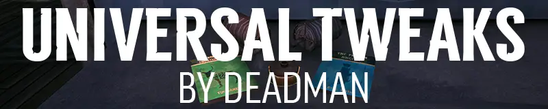

     

Universal Tweaks is a [MelonLoader](https://github.com/LavaGang/MelonLoader) mod for [The Long Dark](https://www.hinterlandgames.com/the-long-dark/) that adjusts lots of small things in the game in ways that just make sense. Every tweak is a setting, and most are off until you turn them on.

## Install

1. Install [MelonLoader](https://github.com/LavaGang/MelonLoader/releases/latest/download/MelonLoader.Installer.exe) into The Long Dark.
2. Install the mods it needs, in the `Mods` folder in the game's folder:
   - [Complex Logger](https://github.com/Arkhorse/Complex-Logger/releases/latest)
   - [ModSettings](https://github.com/DigitalzombieTLD/ModSettings), for the mod's settings menu (Complex Logger needs it too)
   - [ModComponent](https://github.com/dommrogers/ModComponent/releases/latest), for the mod's translations
3. Download [UniversalTweaks.dll](https://github.com/Deaadman/universal-tweaks/releases/latest/download/UniversalTweaks.dll) and put it in the `Mods` folder too.
4. Start the game.

To update, replace `UniversalTweaks.dll` with the new one. To uninstall, delete it.

Each release says which version of The Long Dark it was made for. After a game update, the mod may not work until it's updated too.

### Doesn't work with

These mods do things Universal Tweaks already does, so don't use them alongside it. Some of them stop it loading.

- [Carry Weight](https://github.com/Xpazeman/tld-carry-weight-mod)
- [Container Tweaks](https://github.com/GruffCassquatch/ContainerTweaks)
- [Disable Breath Effects](https://github.com/Thekillergreece/DisableBreathEffect)
- [Enable Feat Progress In Custom Mode](https://github.com/RomainDeschampsFR/EnableFeatProgressInCustomModeLegacy)
- [Limitless Container Space](https://github.com/Atlas-Lumi/LimitlessContainerSpace)
- [TLD_NonPotableToiletWater](https://github.com/Ezinw/TLD_NonPotableToiletWater)
- [Unlimited Rock Caches](https://github.com/dommrogers/UnlimitedRockCaches)

### Nightly builds

Every change is built straight away and published as the [nightly release](https://github.com/Deaadman/universal-tweaks/releases/tag/nightly). It has the newest fixes and features, but it may be unstable. Back up your saves first.

## What it does

| Area | What you can change |
| --- | --- |
| Carry weight | Carry more, or a practically unlimited amount, without the extra weight making each kilogram burn fewer calories |
| Containers | How much each kind of container holds, or a practically unlimited amount |
| Flashlights | Use them outside auroras, keep them lit when dropped, change how long the battery lasts, how bright and far the beams reach and what colour they are, and stop the flicker |
| Food and drink | Remove the headache from pies and porridge, change how long insulated flasks stay hot and how much fatigue stews take away, and make toilet water potable or not |
| Rock caches | Build them indoors, and change how many you can build and how far apart |
| Spray paint | Make decals glow in the dark, place them closer together, and mark the map whatever the visibility |
| Travois | Change how fast it turns, how steep a slope it can take and how fast it decays, and take it anywhere |
| Other | Hide your breath, a brown MRE, noisemaker fuse and throw, respirator canister duration, snow shelter decay, walking while aiming the revolver, random drop rotation, feat progress in custom games, an always-on crosshair, and hiding main menu adverts |
| Fixes | Resetting a snare from the inspect menu after a rabbit is caught, spray paint greyed out in the radial menu without a can, and the fire sprite lined up on the feed fire panel |

[How it all works](docs/features.md) has every setting and its default.

## Bugs and ideas

Found a bug? Use the [bug report form](https://github.com/Deaadman/universal-tweaks/issues/new?template=bug_report.yml). It asks for `MelonLoader\Latest.log` from your game's folder, with every level turned on in Complex Logger's settings.

Have an idea? Use the [feature request form](https://github.com/Deaadman/universal-tweaks/issues/new?template=feature_request.yml).

## Learn more

- [How it works](docs/features.md): every setting, what it does and its default
- [Building from source](docs/development.md)
- [Changelog](CHANGELOG.md)

## Thanks

- [Jods](https://github.com/Jods-Its) and [Kaiusername](https://github.com/Kaiusername), for the brown MRE's icon and texture.
- [Elderly-Emre](https://github.com/Elderly-Emre), for the Turkish translations.
- [Xpazeman](https://github.com/Xpazeman), [Cass](https://github.com/GruffCassquatch), [Emma](https://github.com/Atlas-Lumi), [Romain](https://github.com/RomainDeschampsFR), [Thekillergreece](https://github.com/Thekillergreece), [zeobviouslyfakeacc](https://github.com/zeobviouslyfakeacc) and [Ezinw](https://github.com/Ezinw), whose mods are part of Universal Tweaks.

## License

Universal Tweaks is licensed under [GPL-3.0](LICENSE).

## Disclaimers

**AI assistance.** Parts of this project, including some of its code, were written with the help of AI coding agents.

**Not affiliated with Hinterland.** Universal Tweaks is an unofficial fan-made mod. It isn't made, endorsed or supported by Hinterland Studio. The Long Dark and its assets are the property of Hinterland Studio. Please report problems with the mod here, not to Hinterland.
